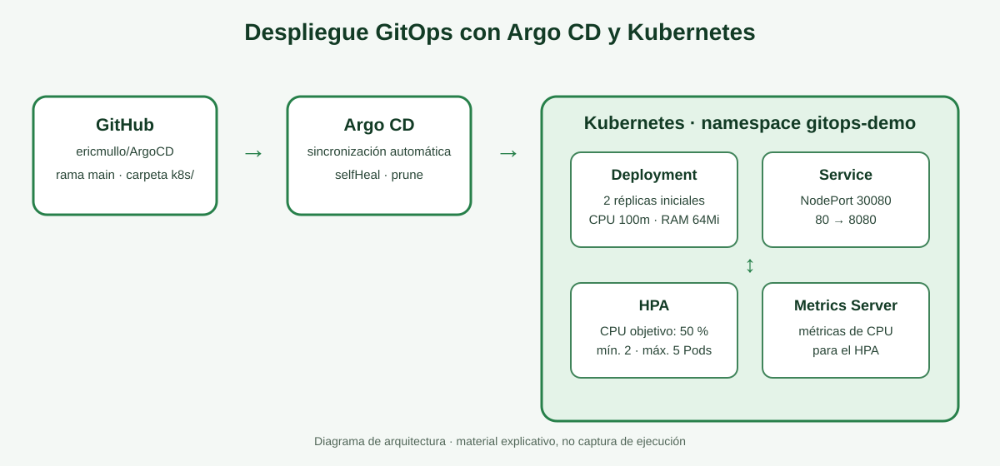
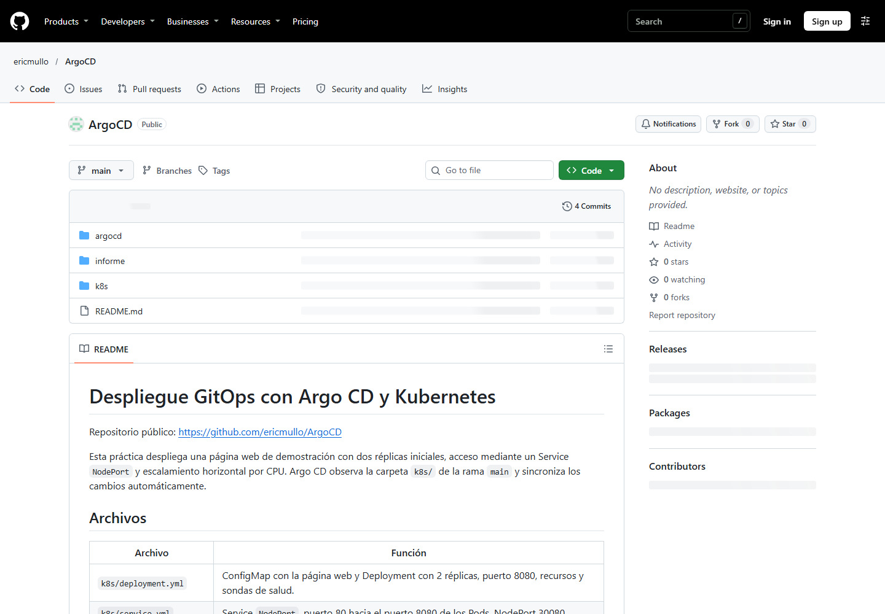
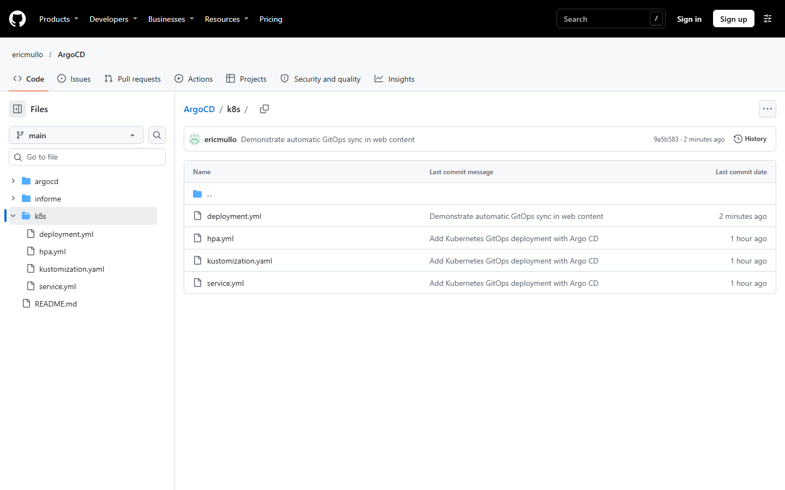
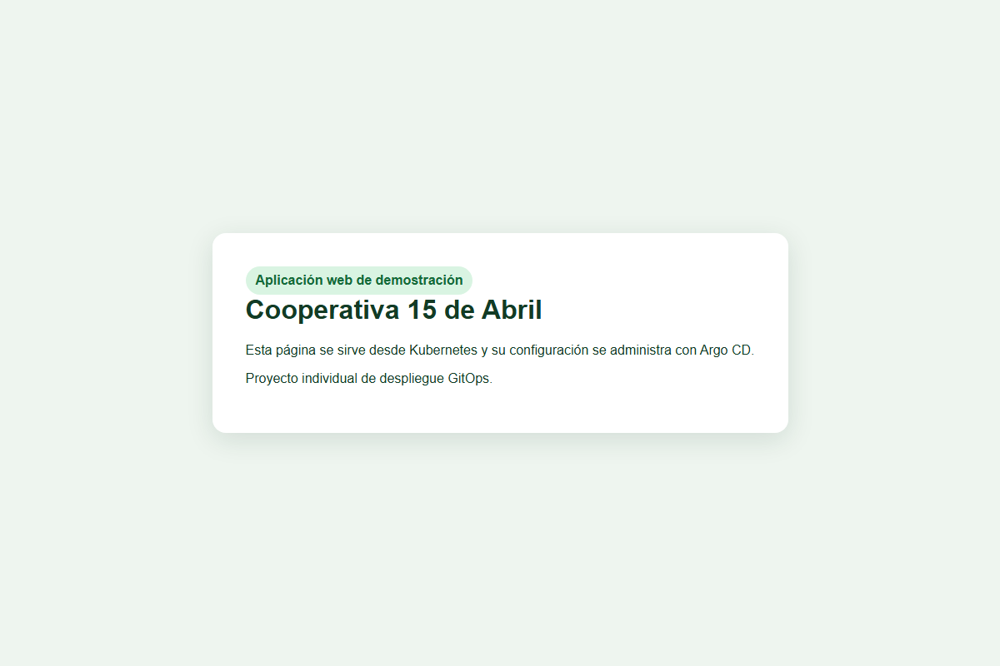
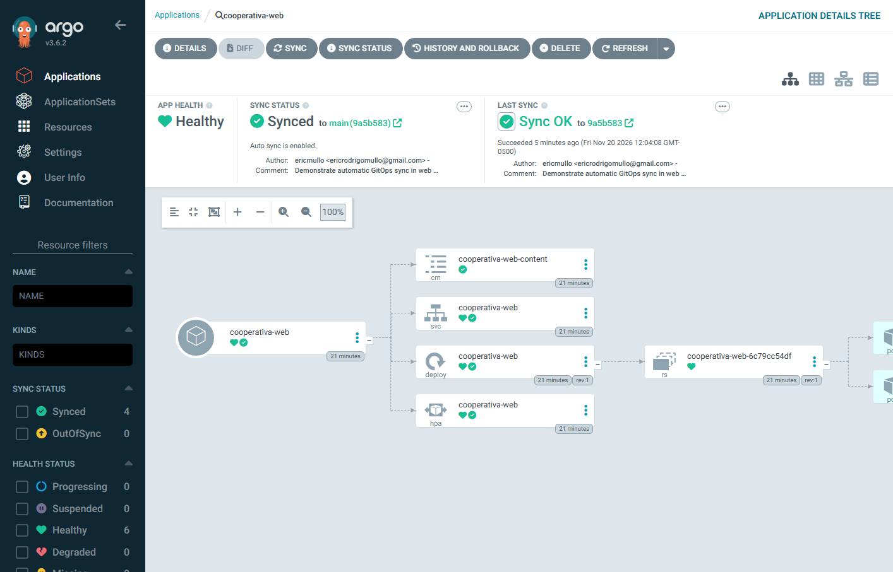
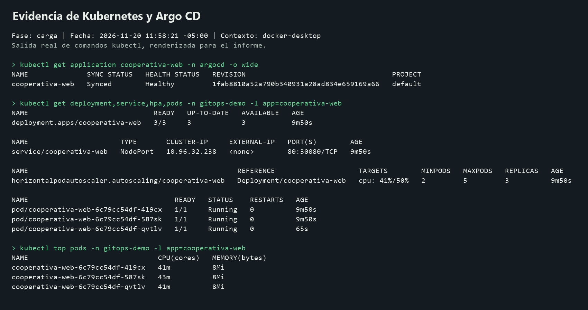
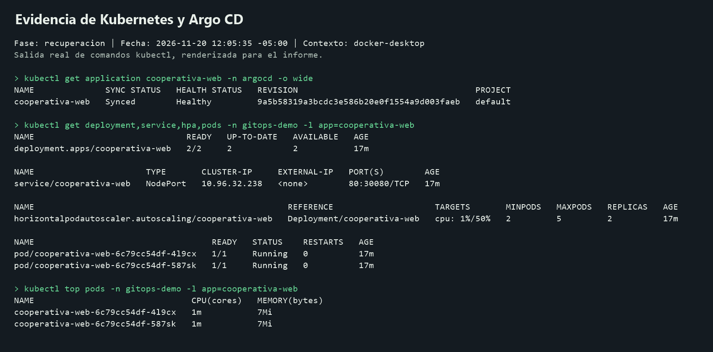
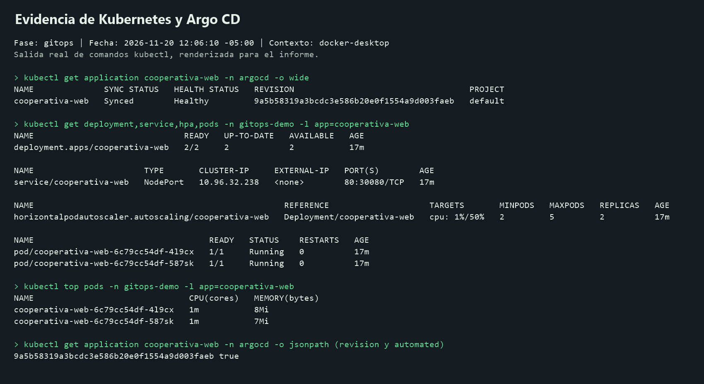
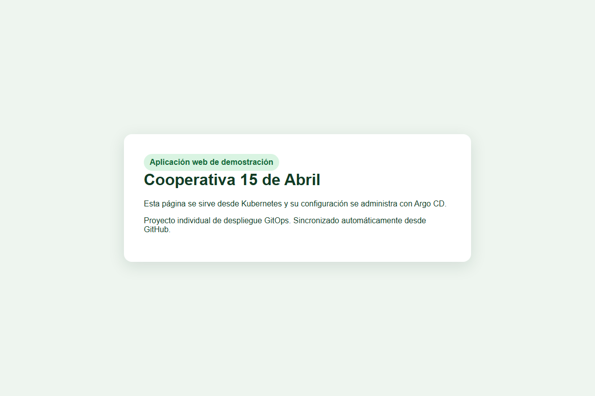

# Informe individual: despliegue de una aplicación con Argo CD y Kubernetes

**Repositorio:** https://github.com/ericmullo/ArgoCD  
**Aplicación:** cooperativa-web  
**Namespace:** gitops-demo  
**Fecha:** 20 de noviembre de 2026  
**Entorno:** Docker Desktop, clúster `kind` de un nodo, Kubernetes v1.36.1

## Objetivo

Desplegar una aplicación web mediante GitOps, usando el repositorio Git como fuente de verdad y Argo CD para sincronizar automáticamente los recursos de Kubernetes.

## Arquitectura

La carpeta `k8s/` contiene un Deployment con dos réplicas iniciales, un Service `NodePort` y un HPA con objetivo de CPU del 50 %, mínimo de dos y máximo de cinco réplicas. Argo CD observa la rama `main` y aplica automáticamente los cambios. Metrics Server proporciona al HPA las métricas necesarias.

## Configuración realizada

| Recurso | Configuración |
| --- | --- |
| Deployment | Imagen pública de Nginx sin privilegios; puerto 8080; CPU solicitada 100m y límite 500m; memoria solicitada 64Mi y límite 128Mi; dos réplicas iniciales. |
| Service | Tipo NodePort, puerto 80, puerto de destino 8080, puerto del nodo 30080; selector `app: cooperativa-web`. |
| HPA | `autoscaling/v2`, CPU 50 %, mínimo 2, máximo 5; objetivo Deployment `cooperativa-web`. |
| Argo CD | Repositorio público, rama `main`, ruta `k8s`, sincronización automática, limpieza y autocorrección. |

## Instalación y validación

Se activó el clúster Kubernetes de Docker Desktop. Se instalaron Argo CD v3.6.2 y Metrics Server v0.9.1. En este clúster de desarrollo, Metrics Server necesitó la opción `--kubelet-insecure-tls` porque no confiaba en el certificado del kubelet. Después del ajuste, `kubectl top nodes` y `kubectl top pods` entregaron métricas de CPU. `kubectl kustomize k8s` procesó los manifiestos correctamente.

### Repositorio Git como fuente de verdad

El repositorio público contiene los tres archivos solicitados, `kustomization.yaml` y la definición de la aplicación Argo CD.

### Despliegue y acceso

Argo CD creó `gitops-demo` y desplegó dos Pods listos. El Service `NodePort` expuso `80:30080/TCP`. Una petición desde el nodo a `http://172.20.0.2:30080` devolvió HTTP `200`. La implementación `kind` de Docker Desktop no publicó ese NodePort directamente en `localhost:30080`; la captura del navegador se tomó mediante `kubectl port-forward -n gitops-demo service/cooperativa-web 18080:80`.

Argo CD mostró el estado `Synced`, `Healthy` y el mensaje `Auto sync is enabled`.

### Escalamiento horizontal

El HPA utilizó las métricas de CPU de Metrics Server. Con 12 Pods temporales generando solicitudes, la aplicación alcanzó un uso de CPU del **60 %**, por encima del objetivo del **50 %**, y pasó de **2 a 3 réplicas**. La siguiente imagen se generó a partir de la salida real de los comandos `kubectl`; el archivo [evidencia-carga.txt](evidencia-carga.txt) conserva el texto original.

Después de eliminar el generador de carga, la CPU volvió aproximadamente al **1 %** y el HPA redujo la aplicación a **2 réplicas**. [evidencia-recuperacion.txt](evidencia-recuperacion.txt) contiene la salida original.

### Sincronización automática desde Git

Se publicó el commit [`9a5b583`](https://github.com/ericmullo/ArgoCD/commit/9a5b58319a3bcdc3e586b20e0f1554a9d003faeb), que añadió el texto “Sincronizado automáticamente desde GitHub” a la página. Sin solicitar una sincronización manual, Argo CD actualizó su revisión a ese commit; el historial de la aplicación mostró `initiatedBy.automated: true`. El ConfigMap y ambos Pods recibieron el texto nuevo. [evidencia-gitops.txt](evidencia-gitops.txt) conserva la salida de los comandos.

## Resultado

El despliegue GitOps funcionó en el clúster local. Se verificaron el Deployment, el Service NodePort desde el nodo, las métricas de CPU, el aumento y descenso del HPA, y la sincronización automática de un commit nuevo. El acceso desde Windows se realizó con `port-forward` porque el NodePort del nodo `kind` no estaba publicado en el host.
