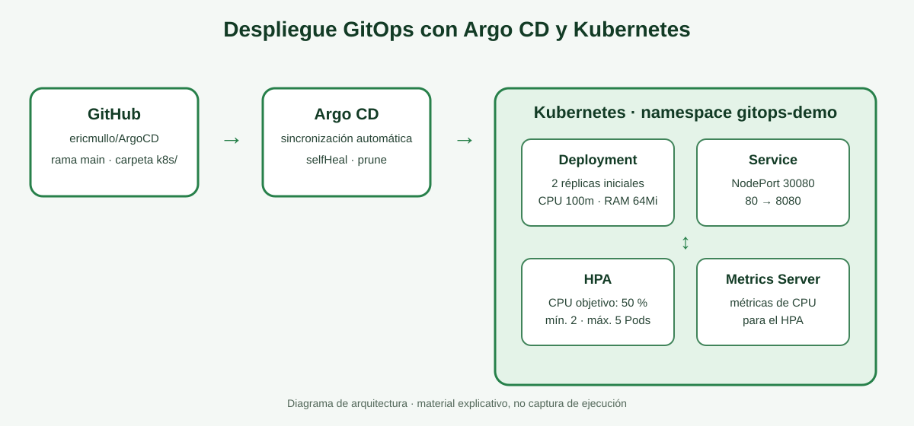

# Informe individual: despliegue de una aplicación con Argo CD y Kubernetes

**Repositorio:** https://github.com/ericmullo/ArgoCD  
**Aplicación:** cooperativa-web  
**Namespace:** gitops-demo

## Objetivo

Desplegar una aplicación web mediante GitOps, usando el repositorio Git como fuente de verdad y Argo CD para sincronizar automáticamente los recursos de Kubernetes.

## Arquitectura

La carpeta `k8s/` contiene un Deployment con dos réplicas iniciales, un Service `NodePort` y un HPA con objetivo de CPU del 50 %, mínimo de dos y máximo de cinco réplicas. Argo CD observa la rama `main` y aplica automáticamente los cambios. Metrics Server proporciona al HPA las métricas necesarias.

## Configuración realizada

| Recurso | Configuración |
| --- | --- |
| Deployment | Imagen pública de Nginx sin privilegios; puerto 8080; CPU solicitada 100m y límite 500m; memoria solicitada 64Mi y límite 128Mi; dos réplicas iniciales. |
| Service | Tipo NodePort, puerto 80, puerto de destino 8080, puerto del nodo 30080; selector `app: cooperativa-web`. |
| HPA | `autoscaling/v2`, CPU 50 %, mínimo 2, máximo 5; objetivo Deployment `cooperativa-web`. |
| Argo CD | Repositorio público, rama `main`, ruta `k8s`, sincronización automática, limpieza y autocorrección. |

## Comprobación realizada

El repositorio público contiene los manifiestos y la definición de Argo CD. `kubectl kustomize k8s` procesó los tres manifiestos correctamente. Esta comprobación valida la estructura local de YAML; **no demuestra ejecución en el clúster**.

## Evidencias de ejecución pendientes

Agregue aquí capturas reales, tomadas después de activar Kubernetes y desplegar Argo CD:

1. Pantalla del repositorio público con los archivos de la carpeta `k8s/`.
2. Aplicación `cooperativa-web` en Argo CD con `Synced`, `Healthy` y `Auto-Sync`.
3. Salida de `kubectl get deployment,service,hpa,pods -n gitops-demo`.
4. Página web abierta desde el NodePort `30080`.
5. Métricas de CPU y aumento de réplicas durante la prueba de carga.
6. Retorno a dos réplicas después de retirar la carga.
7. Cambio en Git y sincronización automática de Argo CD.

Incluya el contexto del clúster y la fecha en las capturas. No use imágenes simuladas como evidencia de ejecución.
